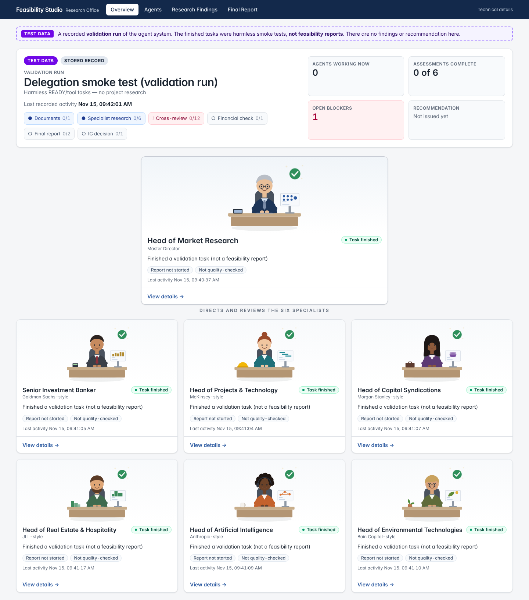

# Claude Feasibility Studio — 7-Agent Market Research & Investment Feasibility Team

A reusable Claude Code workspace for institutional-grade market research and investment feasibility studies.
One **Head of Market Research (Master Director)** plans the work, delegates to **six specialist subagents**, runs a
structured cross-review, reconciles conflicts and issues an investment-committee recommendation:
**GO / CONDITIONAL GO / DEFER / NO-GO**.

> The institutional perspectives (Goldman Sachs, McKinsey, Morgan Stanley, JLL, Anthropic, Bain Capital) are
> **simulations of analytical methods**. The agents are not employees, affiliates or authorised representatives of
> those firms, and outputs are decision support — not licensed valuation, engineering, legal, tax or lender diligence.

**Status:** setup complete, no study run. Waiting for Phase 2 (a real project brief and source documents).

---

## The team

| Agent (`name`) | Role | Perspective | Model |
| --- | --- | --- | --- |
| `head-of-market-research` | Global Head of Market Research & Investment Feasibility — Master Director | IC research director | opus |
| `investment-banking` | Senior Investment Banker — financial feasibility, DCF, NPV/IRR/MOIC, WACC, scenarios, bankability | Goldman Sachs-style | opus |
| `project-technology` | Head of Projects & Technology — deliverability, infrastructure, phasing, procurement, critical path | McKinsey-style | sonnet |
| `syndications` | Head of Syndications — capital stack, investors, lenders, covenants, raise sequence, exit | Morgan Stanley-style | opus |
| `real-estate-hospitality` | Head of Real Estate & Hospitality — demand/supply, comps, ADR/occupancy/RevPAR, absorption, mix | JLL-style | sonnet |
| `ai-strategy` | Head of AI — credible AI use cases, build vs buy, ROI, governance, security | Anthropic-style | sonnet |
| `environmental-technologies` | Head of Environmental Technologies — energy, water, waste, resilience, permits, green finance | Bain Capital-style | sonnet |

Change any `model:` to `opus`, `sonnet`, `haiku` or `inherit` in `.claude/agents/<name>.md` to trade cost for depth.

## Repository layout

```
.claude/agents/   7 subagent definitions (frontmatter + system prompts)
CLAUDE.md         Shared charter: research standards, evidence labels, workflow, cross-review matrix, verdict scale
inputs/           PROJECT_BRIEF.md, source_documents/ (sponsor study etc.), confidential/ (git-ignored), examples/
research/         00_director/ (plan, briefs, RUN_LOG, reconciliation), one folder per specialist, cross-review/
models/           MODEL_SPEC.md, input/cash-flow templates, scripts/fincalc.py (NPV/IRR/MOIC/DSCR/WACC), tests
outputs/          Final executive summary, report, scenarios, registers, recommendation
templates/        Research plan, task brief, run log, findings, cross-review, summary, report, scenarios,
                  recommendation, source/assumption/risk/disagreement registers
prompts/          START_FULL_STUDY, START_MARKET_SCAN, CHALLENGE_ROUND, ORCHESTRATE_FALLBACK, SMOKE_TEST_DELEGATION
scripts/          validate_agents.py (static validation)
docs/             Original archive (provenance) and a Claude.ai single-assistant alternative
```

## How the multi-agent workflow runs

1. **Assignment** — the Director reads `CLAUDE.md`, the brief and all inputs.
2. **Research plan** — `research/00_director/study_plan.md` + a self-contained brief per specialist.
3. **Independent research** — all six specialists run (in parallel) and write to `research/<agent>/`.
4. **Collection** — the Director reads all outputs and logs every run in `RUN_LOG.md`.
5. **Cross-review** — each specialist challenges two other workstreams (`CLAUDE.md` §5 matrix).
6. **Reconciliation** — conflicts logged and resolved on evidence; unresolved dissent stays visible.
7. **Integration** — one assumption register and one financial model (`models/`).
8. **Report and verdict** — `outputs/`, with GO / CONDITIONAL GO / DEFER / NO-GO.

### Orchestration modes
| Mode | How | When |
| --- | --- | --- |
| **A. Director as main thread** | `claude --agent head-of-market-research` | Local CLI / desktop. The `Agent(...)` allowlist restricts delegation to the six specialists. ✅ tested |
| **B. Director as subagent (nested)** | In a normal session: "Use the head-of-market-research subagent to …" | Only where nested spawning is enabled. ❌ **Not available in Claude Code on the web** (`CLAUDE_CODE_MAX_SUBAGENT_SPAWN_DEPTH=1`). |
| **C. Fallback — main session orchestrates** | Paste `prompts/ORCHESTRATE_FALLBACK.md` into a normal session | **Recommended in Claude Code on the web.** The main session calls all seven agents explicitly. ✅ tested |

Every mode records actual runs in `research/00_director/RUN_LOG.md`. A specialist that failed is reported as
NOT EXECUTED — never written up from general knowledge.

## Phase 2 — how to upload your feasibility study

1. **Add documents** to `inputs/source_documents/` (sponsor study, master plan, cost plan, market reports, data in
   PDF/XLSX/CSV/DOCX/MD). Put anything confidential in `inputs/confidential/` (git-ignored). Either commit/upload them
   to this branch on GitHub, or attach them in the Claude Code chat and ask Claude to save them there.
2. **Fill in `inputs/PROJECT_BRIEF.md`** — or ask the Director to draft it from your documents, with every field
   labelled VERIFIED / SPONSOR / UNKNOWN for your review.
3. **Start the study**:
   ```bash
   claude --agent head-of-market-research
   ```
   then paste `prompts/START_FULL_STUDY.md` (or `prompts/START_MARKET_SCAN.md` for a quick screen).
   **On Claude Code on the web**, open a session on this repository and say: *"Run the full study in fallback
   mode following prompts/ORCHESTRATE_FALLBACK.md."*
4. **Review** `outputs/00_executive_summary.md`, `outputs/04_recommendation.md`, `outputs/disagreement_log.csv`
   and `research/00_director/RUN_LOG.md`.

## Research Command Center (dashboard)

`dashboard/` contains a private web dashboard: agent cards with recorded status, an agent detail timeline, the
research workflow, an activity feed, studies with comparison, and reports. Claude Code hooks feed it real subagent
lifecycle events, with no simulated status. It can run in-session (preview port 4317) or as a persistent,
authenticated deployment. See [`dashboard/README.md`](dashboard/README.md) for the architecture, live vs stored data,
deployment and security.



## Validation

```bash
python3 scripts/validate_agents.py
```

```bash
python3 -m unittest discover -s models/tests
```

The live delegation smoke test (agents reply READY, no research) is in `prompts/SMOKE_TEST_DELEGATION.md`.
Results of the setup-phase tests are recorded in `docs/SETUP_VALIDATION.md`.

## Optional: experimental agent teams
Claude Code's experimental agent teams let teammates message each other directly (higher cost). Not enabled by
default. To try it, add `{"env":{"CLAUDE_CODE_EXPERIMENTAL_AGENT_TEAMS":"1"}}` to `.claude/settings.json`; see
https://code.claude.com/docs/en/agent-teams. The standard subagent workflow above does not need it.

## Privacy
This repository may be public. Do not commit confidential financials, contracts, personal data or API keys —
use `inputs/confidential/`. Agents are instructed not to put confidential figures into web searches.

## References
- Claude Code subagents: https://code.claude.com/docs/en/sub-agents
- Original configuration archive: `docs/claude_agents_for_web_github.zip`
