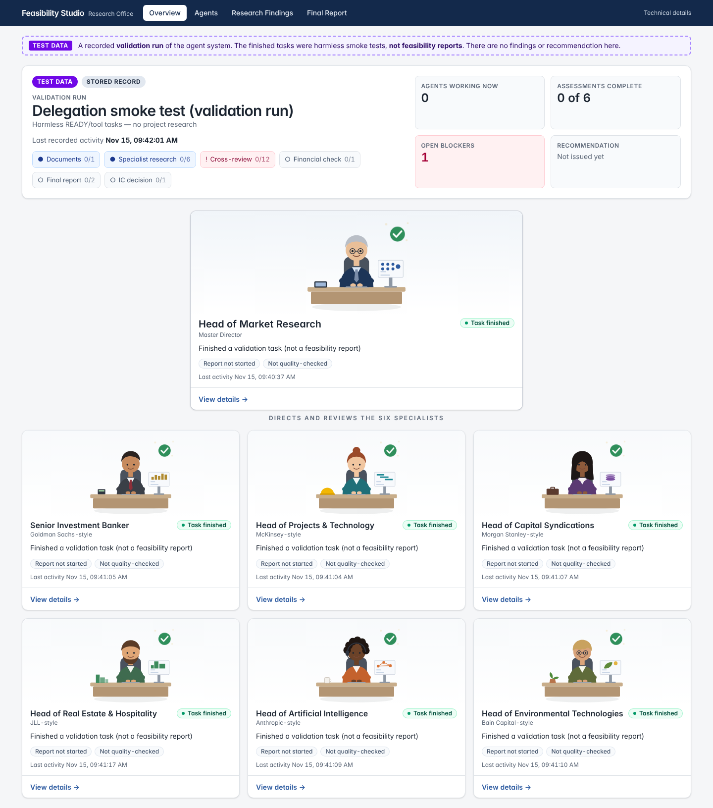

# Feasibility Studio — Research Command Center

A private web dashboard for monitoring the seven-agent Feasibility Research Studio during a study, and for reviewing
stored studies afterwards. It is built with React, TypeScript and Tailwind CSS, served by a small Node/Express server
with a SQLite store.

**Every status on screen is derived from recorded Claude Code execution events.** There are no simulated statuses,
progress percentages, timers or demo data. When no live data is flowing, the dashboard says so and shows the last stored
state.



## The research office (v2)

The home page is a virtual research office. The **Head of Market Research** sits at the top, directing six specialists,
each drawn as an original illustrated character (SVG; no logos, no likenesses of real people). Navigation has four
items: **Overview / Agents / Research Findings / Final Report**. Raw logs, run IDs, file names and sessions live under
**Technical details**.

| Character pose | Shown when (recorded events only) |
| --- | --- |
| Typing at the desk | A run is in progress (`SubagentStart` with no completion yet) on research work |
| Reading a document | A run is in progress on document analysis, cross-review or the final report |
| Hourglass | A task is assigned or dispatched, but the agent has not started |
| Green check (one-time pop) | Its latest task finished |
| Warning sign | Its latest task failed, was stopped, or its session ended mid-run |
| Motionless, screen off | Nothing recorded |

Only the two in-progress poses move continuously. All motion stops under `prefers-reduced-motion`. The mapping is the
pure function `poseFor()` in `shared/presentation.ts`, covered by `tests/presentation.test.ts`.

**Three separate facts per agent.** Never one combined "done" flag:
1. **Task status** — from hook events (Working / Waiting / Task finished / Problem / Idle).
2. **Report readiness** — which required deliverables exist (`findings.md`, `sources.csv`, `assumptions.csv`,
   `risks.csv`; for the Director, the eight final outputs).
3. **Quality** — the recorded result of `scripts/studio/quality_gate.py`: NOT CHECKED, PASS or FAIL, with every check
   listed.

An **assessment is complete** only when the report is ready **and** the quality gate passed. A `SubagentStop` alone
never completes an assessment. Findings, verdicts and risks shown on cards are **copied from the agent's own report**
(`shared/insights.ts`); nothing is generated.

**Data mode labels:**

| Label | Meaning |
| --- | --- |
| **TEST DATA** | A validation run; also shown as a page-wide banner |
| **LIVE** | Self-served dashboard, stream connected and a recorded session open |
| **SYNCED SNAPSHOT** | The hosted claude.ai page, current as of its last sync |
| **STORED RECORD** | Nothing is running |
| **NOT LIVE** | Connection lost |

**Downloads.**
- Self-served: an authenticated attachment endpoint, `GET /api/studies/:slug/download?path=`.
- Hosted: the claude.ai save prompt (`downloads` capability).

**Deep links (hosted).** `#overview`, `#agents`, `#findings`, `#final-report`, `#technical`, `#agent-<agent-name>`.

### Quality gate

```bash
python3 scripts/studio/quality_gate.py <agent>   # or --all
```

Writes `research/<agent>/quality_check.json` (Director: `outputs/quality_check.json`) and delivers it to the dashboard.

- **Specialist checks:**
  - report of at least 2,500 words, with the required sections
  - a stated verdict and at least 3 evidence labels
  - at least 8 sources, 6 of them with URLs
  - at least 8 registered sources cited by ID, and every cited ID resolves to the register
  - at least 5 assumptions using valid labels, at least 5 risks, at least 3 failure modes
- **Director checks:** all eight outputs present, an integrated report of at least 4,000 words covering all six
  workstreams, one verdict, at least 3 disagreements, at least 30 consolidated sources, and all six specialist gates
  passed.

The gate checks structure and evidence hygiene, **not** whether conclusions are right.

## How it works

```
Claude Code session (orchestrator, FALLBACK mode)
  │  hooks in .claude/settings.json: SessionStart/End, Stop, Subagent{Start,Stop}, Pre/PostToolUse(+Failure)
  ▼
scripts/studio/hook.py ── normalise ──► .studio/outbox/<study>.jsonl   (always written first; durable local queue)
  │                                        │
  │  POST /api/ingest/{events,documents}   │  `studio.py sync` re-sends anything not acknowledged
  ▼  (bearer ingest token; idempotent)     ▼
dashboard server (Express + node:sqlite) ── events (append-only) · documents (+ every version) · agents · users
  │  derives state on every read (shared/derive.ts — pure, tested)
  │  Server-Sent Events: "new data recorded" → browser re-fetches the derived state
  ▼
browser (React) — Command Center · Agent detail · Workflow · Activity feed · Studies & compare · Reports
```

* **Recorder** (`scripts/studio/`, Python standard library only). Hooks call `hook.py`, which records nothing unless a
  study is active (`studio.py study start …`). It never writes to stdout and always exits 0, so it cannot block or alter
  Claude Code. Payload shapes were captured from Claude Code 2.1.325 and are covered by `test_hook.py`.
* **Server** (`server/`). Stores events idempotently by UUID and every distinct document version, derives agent and
  stage status on each read, and pushes a "data changed" notification over SSE.
* **Insights** (`shared/insights.ts`, `shared/presentation.ts`). Report readiness, quality results, summaries copied
  from reports, risk ordering, pose mapping and data-mode labels.
* **Derivation** (`shared/derive.ts`). Pure functions with no clocks or timers. Every status carries its basis, for
  example "SubagentStart recorded at 09:40:44; no completion event recorded yet". Covered by `tests/derive.test.ts`.

### What the hooks capture

| Claude Code hook | Recorded as | Used for |
| --- | --- | --- |
| `PreToolUse` (Agent) | `task.dispatch` (agent, description, `[stage:…]` tag, background flag, prompt excerpt) | Current task, stage attribution |
| `SubagentStart` / `SubagentStop` | `agent.start` / `agent.stop` (run id, final message excerpt) | Working / Completed, task ledger |
| `PostToolUse` (Agent) | `task.result` (authoritative `agentId`, tokens, duration, model) | Links a dispatch to its run; foreground completion |
| `PostToolUseFailure` (Agent) | `task.failure` (error text) | Error status |
| `PostToolUse` (TaskStop) | `agent.killed` | Error status. A stopped background agent emits **no** `SubagentStop`, so this is essential. |
| `SessionStart` / `SessionEnd` / `Stop` | `session.*` | Live indicator; runs still open when the session ends are marked **interrupted** |
| `PostToolUse` (WebSearch, WebFetch, Write, Edit, Bash, Read inside subagents) | `tool.use` / `tool.error` / `file.write` | Research activity, sources, deliverables, errors |
| `studio.py assign` (operator command) | `task.assign` | Outstanding tasks / Waiting |

Documents written under `research/`, `outputs/` and `models/` (Markdown, CSV, JSON, text) are uploaded with their
SHA-256 when an agent writes them, and again by `studio.py sync`. Files under `inputs/` (including
`inputs/confidential/`) are **never** uploaded; the server also rejects any path outside those three folders.

### Status rules (from recorded events only)

| Status | Rule |
| --- | --- |
| **Working** | A run has `agent.start` and no completion, kill, failure or session end recorded yet |
| **Waiting** | A task is assigned (`task.assign`) or dispatched, and its agent has not started |
| **Completed** | The latest finished task completed (`SubagentStop` or a completed tool result) and nothing is open |
| **Error** | The latest finished task failed, was stopped (`TaskStop`), or was interrupted because its session ended |
| **Idle** | Nothing recorded for this agent in this study |

Workflow stages use the stage tags plus the presence of each stage's expected deliverables. The Investment committee
decision completes only when `outputs/04_recommendation.md` contains a real verdict, not the template placeholder.
Stages show counts ("4 of 6 expected deliverables recorded"), never percentages.

## Live vs stored — exactly what you are seeing

| Indicator (top banner) | Meaning |
| --- | --- |
| **LIVE** | The browser's event stream is connected **and** a recorded orchestration session has started and not ended. New hook events appear within about a second of happening (hook POST → SSE → re-fetch). |
| **STREAM CONNECTED · NO ACTIVE SESSION** | The server is reachable, but no session is open. You are looking at the stored record as of the last event shown. |
| **NOT LIVE** | The event stream is disconnected. The page keeps the last snapshot it loaded and shows when that snapshot was loaded. |

| Information | Live or stored | Source |
| --- | --- | --- |
| Agent status, current task, last activity, task ledger | **Live** while a session is open; otherwise stored | Hook events |
| Activity feed, errors, research activity (searches, fetched URLs, files written) | **Live** / stored | Hook events |
| Deliverables, findings, reports, registers | **Stored copy** uploaded when the agent writes the file. Edits made outside Claude Code appear after `studio.py sync`. | Document upload |
| Sources tab | Stored: the agent's `sources.csv` rows, plus WebFetch/WebSearch calls recorded live | Documents + events |
| Disagreements | Stored: `outputs/disagreement_log.csv` and `research/cross-review/*` memos | Documents |
| Verdict, compare metrics | Stored: parsed from the final outputs and registers | Documents |
| Agent names and roles | Configuration (`.claude/agents/*.md`) | Agent registry |

**Known limits.** A session that crashes without `SessionEnd` cannot be distinguished from a slow one. Its agents keep
showing **Working** with the start time and the "no completion event recorded yet" basis, and nothing changes on a
timer. Events are recorded at hook granularity; nothing inside a single model turn is visible.

## Deployment and live-status architecture

A Claude Code on the web session is an ephemeral container. Its processes stop when the session idles, and its disk is
discarded when the container is reclaimed, so **the session itself is not a reliable web host.** Two modes are
supported, using the same code.

### Mode 1 — In-session preview (zero setup, not durable)
Use this while a study is running in a Claude Code web session:

```bash
cd dashboard && npm ci && npm run build && npm start
```

The server binds to `127.0.0.1:4317`. The Claude app's preview pane can show this port. Hooks deliver events locally
with no token. Browser auth is off in this mode because only loopback is reachable. **The database lives in the
container**, so export the study before the session ends:

```bash
python3 scripts/studio/studio.py export <slug> <file.json>
```

Store the bundle privately; it contains research content.

### Mode 2 — Persistent private deployment (recommended for anything you want to keep)
Run the Docker image on any host with a persistent volume and HTTPS: a VM, Fly.io, Render, Railway, an internal
Kubernetes cluster, and so on.

1. Build the image (from the repository root):
   ```bash
   docker build -f dashboard/Dockerfile -t feasibility-studio-dashboard .
   ```
2. Create the first admin (the password is read from the environment, never from arguments):
   ```bash
   docker run --rm -v studio-data:/data -e STUDIO_NEW_PASSWORD='…' feasibility-studio-dashboard node server/dist/server/src/cli.js add <you> --role admin
   ```
3. Run it behind HTTPS with a random ingest token of at least 32 characters:
   ```bash
   docker run -d -p 4317:4317 -v studio-data:/data -e STUDIO_INGEST_TOKEN=<random> feasibility-studio-dashboard
   ```
4. Point the recorder at it:
   ```bash
   python3 scripts/studio/studio.py config --server https://<host>
   ```
   * **Claude Code on the web:** add the host to the environment's allowed network hosts. Store the ingest token as a
     network **credential** for that host, so the proxy injects `Authorization: Bearer …`; no token sits in files or
     environment variables.
   * **Local CLI:** export `STUDIO_INGEST_TOKEN`.
5. Optional: import earlier in-session studies with `studio.py import <bundle.json>`.

With Mode 2, hooks POST every event as it happens, so the hosted dashboard is **live from any browser** while a
session runs. Every study, its events and every document version persist on the volume.

### Mode 3 — Private hosted page on claude.ai (no hosting account needed)
The same React app is built as a single page (`npm run build:artifact` → `dist/artifact/command-center.html`) and
published as a **private claude.ai artifact**. Access is through your claude.ai login: only you, plus anyone you add
from the page's Share menu, can open it. Its data lives in the artifact's database. The database rules let everyone
admitted read it and **only the owner write it**, and Claude writes as you through its `ArtifactData` tool.

How updates reach it. The hooks keep recording into the in-session server exactly as in Mode 1. The orchestrating
Claude session then syncs a snapshot:

```bash
python3 scripts/studio/studio.py artifact-export <slug> <dir>
```

This writes one JSON file per database document, plus `manifest.json`. Claude then writes those files with
`ArtifactData` `batch` (up to 50 writes per batch). Existing documents need their current `version` as `if_version`,
so list the collections first. The open page re-renders the moment a sync lands; no reload is needed.

What "live" means here. The page is exactly as current as the last sync. Its banner shows **SYNCED · STUDY RUNNING**
(an orchestration session was open at that sync) or **STORED RECORD**, always with the sync time and the time of the
last recorded event it covers. Events recorded between syncs appear at the next sync. During a study, the orchestrator
syncs after every dispatch round and every agent completion. For hook-by-hook real-time viewing from any browser, use
Mode 2.

Limits: 256 KiB per document (the exporter trims the oldest feed and activity detail first, and splits large reports
into parts) and 25,000 documents per artifact.

### Security and access control
* **Browser authentication:** username/password (scrypt), opaque HttpOnly `SameSite=Strict` session cookie (`Secure`
  by default off loopback), 12-hour sessions stored hashed. Login is rate-limited. Roles are `admin` and `viewer`, and
  all browser endpoints are read-only.
* **Machine ingest:** a separate bearer token, compared in constant time. Ingest payloads are schema-validated, and
  document paths are restricted to `research/`, `outputs/` and `models/`, with no traversal.
* **Safe defaults:** the server **refuses to start** on a non-loopback address without authentication, without an
  ingest token, or without any users.
* **Headers:** strict Content-Security-Policy, `frame-ancestors 'none'` / `X-Frame-Options: DENY` when deployed,
  `nosniff`, `no-referrer`, `no-store`.
* **Data placement:** study data (events, documents, the SQLite file, `.studio/`) is git-ignored and never committed.
  For an internet-facing deployment, consider an identity-aware proxy (for example Cloudflare Access or an OAuth proxy)
  in front as a second factor.

## Operating a study with the dashboard

`prompts/ORCHESTRATE_FALLBACK.md` contains the full procedure. In short:

```bash
python3 scripts/studio/studio.py study start aquaverse-2026 --name "Aquaverse Resilient Integrated Destination" --location "Chonburi, Thailand"
```

```bash
python3 scripts/studio/studio.py assign real-estate-hospitality --stage independent-research --title "Market demand and comparables"
```

Then dispatch agents with stage-tagged descriptions, for example `[stage:independent-research] …`. When the study is
complete:

```bash
python3 scripts/studio/studio.py sync
```

```bash
python3 scripts/studio/studio.py runlog --write
```

```bash
python3 scripts/studio/studio.py study stop
```

Hooks load when a Claude Code session **starts** in this repository, so start a new session after pulling this change.

## Development and tests

```bash
cd dashboard && npm ci
```

Unit tests (derivation, API, auth, startup safety):

```bash
cd dashboard && npm test
```

Hook recorder tests:

```bash
cd dashboard && npm run test:hooks
```

Type checks:

```bash
cd dashboard && npm run typecheck
```

Screenshot tour against a running server:

```bash
cd dashboard && npm run test:e2e
```

## Validation performed (2026-11-15, Claude Code 2.1.325, Claude Code on the web)

* Hook payloads were captured from real `claude -p` runs, covering foreground and background subagents, a subagent
  Write, an unknown agent type, and a background agent stopped with TaskStop.
* A real fallback-mode smoke run was recorded through the hooks into the server (study
  `validation-smoke-2026-11-15`). It had seven assignments, the Director (foreground), six specialists (background, one
  web search) and one deliberate failure. The dashboard showed **LIVE** with Working/Waiting agents during the run, and
  afterwards seven Completed agents, seven deliverables, one recorded web search and Cross-agent review at
  **Attention** (the deliberate failure). See `docs/screenshots/`.
* The live run exposed one defect, which is fixed and covered by a regression test: background launches report
  `agentId` about 13 ms **before** `SubagentStart`.
* Secured mode was exercised against a real server process: unsafe-start refusals, 401 without login or token, browser
  login, token-authenticated ingest, and a bundle export/import moving the validation study to the secured server.
* The Docker image could not be built here because no Docker daemon is available. Its build and run steps were
  reproduced in a clean copy (`npm ci` → build → prune dev dependencies → start with production settings).
